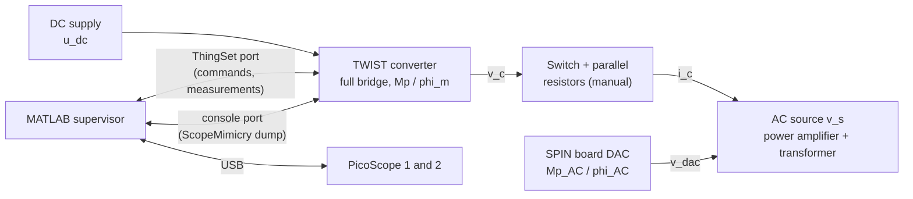
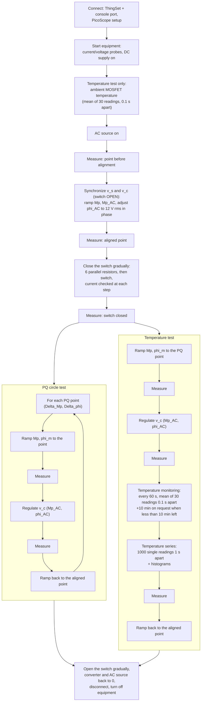

# ThingSet Serial Shell Example

This example shows how to expose data over the Zephyr shell using the [ThingSet](https://thingset.io) protocol, reachable on a dedicated serial (USB-CDC) port separate from the console.

# ThingSet protocol

Data is exchanged using the ThingSet protocol, in Text Mode (JSON payloads over a byte stream). 

!!! Note 
    Full specification can be accessed here: [thingset.io](https://thingset.io).

# Files in this example

- `main.cpp` — plain example: a background task blinks the LED and reads
  temperature sensors, a critical task reads voltage/current sensors. No
  inverter or control-loop code.
- `user_data_objects.h` — the ThingSet object definitions: a read-only
  `Measurements` group and a writable `Config` group.
- `app.conf` — enables the ThingSet stack and the shell transport.
- `app.overlay` — adds a second USB-CDC UART dedicated to the ThingSet
  shell, so it doesn't collide with console output.
- `thingset_tools.py` — a host-side Python helper for talking to the
  device.
- `thingset_example.py` — a usage example for `thingset_tools.py`.

See [`THINGSET_SERIAL_EXAMPLE.md`](../THINGSET_SERIAL_EXAMPLE.md) at the
repo root for the full build/flash instructions and design rationale.

# App.conf

`app.conf` permits simply adding complex modules. In this example, ThingSet
and its shell transport are enabled by setting:

```
CONFIG_OWNTECH_COMMUNICATION_ENABLE_CAN=y
CONFIG_THINGSET_SHELL=y
```

(`CONFIG_OWNTECH_COMMUNICATION_ENABLE_CAN` is currently the only Kconfig
switch that reaches ThingSet at all in this repo, even though this example
only uses the shell/serial transport — see `THINGSET_SERIAL_EXAMPLE.md` for
why.)

You might want to run GUIconfig in `OwnTech -> [Advanced] Run GUIconfig` to
get extra information on available options that can be defined in
`app.conf`. Relevant configs are found in
`Modules -> thingset-sdk -> Thingset SDK`.

# app.overlay

Adds a second CDC-ACM UART instance and routes `zephyr,shell-uart` to it, so
the ThingSet shell has its own port, independent of the console.

# user_data_objects.h

This file is a manifest that lets you define custom values exposed over 
ThingSet. Item names follow the convention `<prefix><Name>_<Unit>`: a
leading `r` marks a read-only value, `w` a writable one (not persisted),
`s` a writable setting (persisted to flash), `x` an executable function;
the suffix after `_` is the physical unit. Follow the syntax provided with
the default measurements to add your own. We also strongly suggest reading
the [ThingSet protocol specification](https://thingset.io/spec/latest/introduction/abstract.html).

# Using the shell (manual discovery)

After building and flashing (see `THINGSET_SERIAL_EXAMPLE.md`), the board
enumerates **two** USB-CDC serial ports (console and shell). 

Open the **shell** one — e.g. `/dev/ttyACM1` on Linux — at 115200 baud (`screen
/dev/ttyACM1 115200`, `minicom`, or any serial terminal).

ThingSet isn't the shell's default command context, so select it first:

```
select thingset
```

Then standard ThingSet Text Mode requests work directly:

```
?                                    # dump the whole tree
?Measurements null                   # list a group's children
?Measurements/rV1Low_V               # GET a single value -> :85 <value>
=Config {\"wBlinkPeriod_s\":0.2}     # UPDATE a writable item -> :84
```

!!! warning **Gotcha:** 
    the Zephyr shell strips *unescaped* double quotes from typed commands before they reach the ThingSet parser, so a naive
    ```
    =Config {"wBlinkPeriod_s":0.2}
    ```
    returns `:A0` (Bad Request). 
    Escape the quotes as shown : 
    ```
    =Config {\"wBlinkPeriod_s\":0.2}
    ```
    GET requests are unaffected since they don't need quotes.

# ThingSet tools (thingset_tools.py)

`thingset_tools.py` is a host-side Python helper (needs `pyserial`) that
wraps the shell dialog above — the `select thingset` step and the
quote-escaping gotcha — behind a small `ThingSetTools` class:

```py
  from thingset_tools import ThingSetTools

  ts = ThingSetTools()                       # port is optional: auto-detected
                                              # by USB VID/PID + handshake probe
  ts.discover()                              # walks the tree, writes thingset_objects.json
  ts.read("Measurements/rV1Low_V")
  ts.write("Config", {"wBlinkPeriod_s": 0.2})

  ts.objects.Measurements.rV1Low_V           # same read, as an attribute
  ts.objects.Config.wBlinkPeriod_s = 0.2     # same write, as an attribute
```


Example 
- `ThingSetTools()` with no `port` auto-detects the device: it tries serial
  ports matching OwnTech's USB VID first (falling back to every port on the
  system), actually opening each and sending the `select thingset` handshake
  - since a board's console and shell ports share the same VID/PID, only the
  shell one responds. Pass a port string (e.g. `"/dev/ttyACM1"`) to skip this
  and connect directly.
- `discover()` recursively walks the device's ThingSet tree and saves it to a JSON file, and populates `ts.objects` for attribute-style access with   tab-completion in an interactive session (IPython/Jupyter).
- `read()` / `write()` are single-path GET/UPDATE calls.
- `read_all()` reads every discovered item into a nested dict in one call.
- `write_values()` writes a nested (or flat-path) dict of values at once,
  rejecting anything that isn't classified writable before sending it.
- `fetch_children(path)` lists a group's child names (used internally by   `discover()`, also handy for building your own lookups — see
  `thingset_example.py`).

# Running the example (thingset_example.py)

Requires `pyserial` (`pip install pyserial`).

`thingset_example.py` connects to the device, discovers its objects,
auto-builds a `{short_name: path}` dict for every item in `Measurements`
(e.g. `"V1Low"` from `"rV1Low_V"`), reads one measurement by its short
name, reads the whole `Measurements` group at once, and writes a `Config`
value both via `write()` and via the attribute proxy.

Edit the port at the top of the script if your board doesn't enumerate as
`/dev/ttyACM1`, then run it from this directory:


```
python3 thingset_example.py
```

# MATLAB version (ThingSetTools.m, thingset_example.m)

`ThingSetTools.m` is a MATLAB port of `thingset_tools.py` covering the same
protocol handling and public API - `discover()`, `read()`/`write()`,
`readAll()`, `writeValues()`, `fetchChildren()`, and port auto-detection via
`findPorts()` - as a `handle` class (needs only base MATLAB, R2019b+, for
`serialport`/`jsonencode`/`jsondecode`; no toolbox required). It does not
port the Python `.objects` attribute-proxy tree (MATLAB struct field names
can't hold arbitrary ThingSet names like `_Reporting` without mangling);
use the methods instead, which MATLAB's own tab-completion already covers.

```matlab
ts = ThingSetTools();                       % port is optional: auto-detected
                                             % by USB VID/PID + handshake probe
tree = ts.discover();                       % walks the tree, writes thingset_objects.json
ts.read("Measurements/rV1Low_V")
ts.write("Config", struct("wBlinkPeriod_s", 0.2))
```

`thingset_example.m` mirrors `thingset_example.py`: it auto-builds a
`containers.Map` of `{short_name: path}` for `Measurements`, reads one
measurement by its short name, reads the whole group at once, and writes a
`Config` value. Run it from this directory with `Home` tab or:

```
run('thingset_example.m')
```

or, from a shell, `matlab -batch "run('thingset_example.m')"`.

# Experimental PQ tests (MATLAB supervisor scripts)

Two MATLAB supervisor scripts drive the single-phase TWIST converter
connected to an AC source and measure its operating points in the PQ plane:

| Script | Test |
|---|---|
| `main_supervisor_script_PQdiagram_HAAS_20261016.m` | **PQ circle** - several PQ points around the aligned point (P, Q) ≈ (0, 0) |
| `main_supervisor_script_PQdiagram_temptest_HAAS_20261016.m` | **Temperature test** - one PQ point held long enough to reach thermal steady state |

The helper functions are in `functions/` (`fcn_*.m`).

## Setup



The converter voltage v_c and the AC source voltage v_s are both generated
from the same internal oscillator of the SPIN board (converter modulation
Mp, phi_m; AC source reference on the DAC, Mp_AC, phi_AC), so once aligned
they stay aligned.

| Measurement | Where |
|---|---|
| i_c_pos, v_dac, v_s, v_c | PicoScope 1 (KP306/0011), ch A-D |
| u_dc (differential probe 1/10), i_dc, i_c_neg, v_s | PicoScope 2 (KP310/0061), ch A-D |
| VHigh, IHigh, Temp1, Temp2, ... | board, over ThingSet (`fcn_converter_acquisition`) |
| Vgrid, I1/I2_low, sine, Vdc, idc, T1, T2, P_board, Q_board, duty cycles, ... | board ScopeMimicry, 1024 samples at 100 µs (`fcn_scope_mimicry_acquisition`) |

The board exposes two USB serial ports: the ThingSet shell (commands and
measurements) and the console, where the ScopeMimicry capture is dumped.
**Close VS Code/PlatformIO terminals and Modular before running a script**:
another program holding the console port makes it fail to open, and setting
the console port to 1200 baud reboots the board into its bootloader.

## Test sequence

Both scripts share the start and the end of the sequence; only the middle
part (in the boxes) differs. Every "measure" step acquires the board
measurements, both PicoScopes and ScopeMimicry, plots them, computes P, Q,
P_dc and the efficiency and saves the point in `PQpoint_<date>_<time>_Mp<Mp>_phim<phi_m>.mat`
(`fcn_save_PQ_point`).



### Common steps

1. **Synchronization** (`fcn_sync_vs_vc`). With the switch open, Mp (v_c) and
   Mp_AC (v_s) are ramped up from 0 and phi_AC is adjusted until both voltages
   reach `syncVref` (12 V rms) and are in phase, with phi_m = 0. This avoids
   an inrush current when the switch is closed. It also stores the no-load
   phase of v_c relative to the internal oscillator (`VcClkRef`), the
   reference of the v_c regulation.
2. **Switch closing.** The user adds the parallel resistors one by one, then
   closes the switch; the current is measured after each step and a warning
   is printed above `maxCurrentClosingA`.
3. **PQ point** (`fcn_ramp_M_phi`). The converter operating point is moved
   from the aligned point (Mp_init, phi_m = 0) by (Delta_Mp, Delta_phi), in
   small steps (`rampMaxStepM`, `rampMaxStepPhi`).
4. **v_c regulation** (`fcn_regulate_Vc`). v_s is generated by a power
   amplifier + transformer, and the closed switch adds a voltage drop between
   v_s and v_c, so the voltage at the converter terminals drops and shifts
   with the converter current. The AC source command (Mp_AC, phi_AC) is
   corrected until v_c is back to its no-load amplitude and phase, like an
   ideal grid at the converter terminals; v_s then differs from v_c by the
   drop across switch + cables, printed at the end of the regulation
   (`|V_s - V_c|`). The DAC output v_dac, measured on the same PicoScope as
   v_c, gives the phase of the internal oscillator.

### PQ circle test

The PQ points are given by `Delta_Mp_list` and `Delta_phi_list`: +/-Delta_Mp
alone, +/-Delta_phi alone and four combined points, i.e. points around the
aligned point. Each point is reached from the aligned point and the converter
is brought back to it before the next one, so every point starts from the
same state.

### Temperature test

One PQ point is held while the MOSFET temperature is recorded at two
placements (board Temp1 and Temp2):

- **Ambient reading**, right after u_dc is turned on and before the
  synchronization: from then on the switch heats up only by having u_dc
  applied, so this is the reference at ambient temperature.
- **Monitoring** (`fcn_monitor_temperature`): every `tempMonitorPeriod_s`
  during `tempMonitorDuration_s`, one reading = mean of `tempBurstCount`
  readings spaced by `tempBurstSpacing_s`. Each printed line gives the
  temperature rate over the last 5 min (°C/min). When less than 10 min is
  left, the script asks whether more time is needed to reach thermal
  equilibrium and adds 10 min if the answer is `y` (asked again near each new
  end). The plot shows the means and the ambient reading (at its negative
  time before the monitoring start).
- **Series** (`fcn_monitor_temperature_series`): `tempSeriesPoints` single
  readings spaced by `tempSeriesSpacing_s`, without averaging, plotted over
  time and as histograms of Temp1 and Temp2 (mean and standard deviation in
  the titles) - the spread of single readings around their mean.

`wBlinkPeriod_s` is set to 0.1 s during the readings so that the board
refreshes Temp1/Temp2 faster than the readings are taken.

## Output files

| File | Content |
|---|---|
| `PQpoint_<date>_<time>_Mp<Mp>_phim<phi_m>.mat` | P, Q (FFT), P_dc, efficiency, operating point (Mp, phi_m, Mp_AC, phi_AC), rms/mean values, temperatures, PicoScope 1 and 2 curves, ScopeMimicry channels (`sm_*`, time `t_sm`) |
| `TempMonitor_<date>_<time>.mat` | monitoring means and individual readings, ambient reading (`tempAmbient`, `tempAmbientTime_s`) |
| `TempSeries_<date>_<time>.mat` | series of single Temp1/Temp2 readings |
